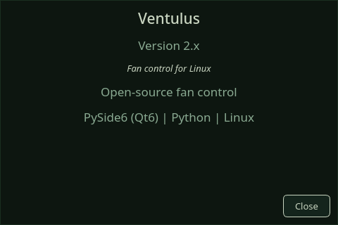

# Getting Started

## What you need

- **x86_64 Linux**: Arch Linux or a distribution built on it such as CachyOS, Debian 13, Ubuntu 26.04 LTS, or Fedora 44 or 45 (see [Installation](#installation), which also lists the distributions that are not supported). Ventulus runs on the distribution's own Python (3.12 or newer), Qt and numpy.
- **ventulusd**, the service that does the hardware work, running under systemd. Installing the `ventulus` package pulls it in.
- A supported fan controller: an OpenFAN controller, motherboard fan headers, or an AMD GPU.

The GUI never accesses hardware directly. All reads and writes go through the daemon's API over a local Unix socket.

### Supported coolers and controllers

The daemon drives hardware only through Linux's own drivers. It never talks to a USB
device directly and does not use `liquidctl`, so what it can reach is what the kernel
exposes.

| Hardware | What Ventulus can do |
|---|---|
| **OpenFAN controller** (USB) | Full control of every channel (see [OpenFAN Controller](openfan-controller.md)) |
| **Motherboard fan headers** (ITE and Nuvoton Super-I/O chips) | Full control on most boards; some need an out-of-tree driver or a BIOS setting first (see [Driver Setup](driver-setup.md)) |
| **Dell laptops and some Dell desktops** (`dell_smm`) | Control on models the kernel driver allows; many share one BIOS switch across every fan (see [Driver Setup](driver-setup.md)) |
| **AMD discrete GPUs** | RX 7000/9000: full control through the firmware fan curve, which needs a one-time kernel setting (see [Driver Setup](driver-setup.md#amd-gpu-fan-control-prerequisite-rdna3)). RX 6000 and older: monitored, and the fan can be tested and reset, but a profile does not drive it: the card's own fan curve stays in charge |
| **Intel Arc and NVIDIA GPUs** | Monitor only: temperature and fan speed. An NVIDIA card of the Turing (RTX 20) generation or newer is seen only through the proprietary driver's opt-in NVML telemetry, not through `nouveau` (see [Hardware Troubleshooting](hardware-troubleshooting.md#nvidia-gpus-are-monitor-only)) |
| **NZXT Kraken X53/X63/X73, Z53/Z63/Z73, Kraken 2023, 2023 Elite and 2024 Elite** (`nzxt-kraken3`; the 2024 Elite needs kernel 7.3 or newer) | Pump and fans controllable, coolant temperature read |
| **NZXT Kraken X42/X52/X62/X72** (`nzxt-kraken2`) | Monitor only: the driver cannot set its speeds |
| **Aquacomputer D5 Next** (`aquacomputer_d5next`) | Pump and fan controllable, coolant temperature read |
| **Aquacomputer High Flow Next and Leakshield** | Coolant temperature read; they drive no fan |
| **Fan controllers:** Corsair Commander Pro, NZXT Smart Device V2 / RGB & Fan Controller, Aquacomputer Octo, Quadro and Aquaero | Fan channels controllable |
| **Any AIO whose pump plugs into a motherboard header** | Controlled as a motherboard header; tell **Configure AIO** which header is the pump so it gets its protection (see [Controls](controls.md#if-your-aio-is-plugged-into-the-motherboard)) |

A cooler with no mainline kernel driver (most USB coolers not listed here) is not
visible to Ventulus. Plugging its pump into a motherboard header, where the cooler
allows it, is the usual way round that.

### Drivers and kernel settings

The package loads the common motherboard sensor drivers for you, so many machines
need nothing more. Two cases do:

- Newer Gigabyte, MSI and some ASRock boards (2022 and later) need an out-of-tree
  driver, built with DKMS from its upstream project (on Arch, from the AUR).
- An AMD RX 7000 or RX 9000 needs the kernel parameter
  `amdgpu.ppfeaturemask=0xfff7ffff` before its fan can be controlled.

You do not have to work this out first. Install, launch Ventulus, and the
**System State** and **Hardware** pages name your chips and say exactly which
driver or setting your machine needs. [Driver Setup](driver-setup.md) has the
copy-paste steps for both cases, including each bootloader and how to undo it
all. The [Setup Checklist](setup-checklist.md) takes you through the whole path in
order, from install to your first profile, and
[Understanding Motherboard Fan Control](understanding-fan-control.md) explains
why each step is needed.

## Installation

Ventulus is packaged for Arch Linux and the distributions built on it, Debian 13,
Ubuntu 26.04 LTS, and Fedora 44 and 45, each from a signed repository that then
upgrades it with the rest of your system. On Arch, for example:

```bash
sudo pacman -Syu ventulus          # once the [ventulus] repository is set up
sudo systemctl enable --now ventulusd
```

[Installing](admin/install.md) has the repository setup for each distribution, the
signing key's fingerprint, the tarball, one-off installs from a release, building
the packages yourself, a machine with no desktop, and the distributions that are not
supported.

## After installing

Reboot, or load the sensor drivers and restart the daemon as
[Installing § After installing](admin/install.md#after-installing) shows: the
package's motherboard sensor drivers load at boot, and until then your
motherboard's fans and temperatures can be missing. You do not need to log out, join
a group, or install `lm_sensors`, DKMS or a driver to start: open Ventulus and let
the **System State** and **Hardware** pages show what your hardware needs. The
[Setup Checklist](setup-checklist.md) takes it from there.

## First launch

```bash
ventulus
```

On first launch, Ventulus will:

1. Attempt to connect to the daemon at `/run/ventulus/ventulus.sock` (`ventulus --socket <path>` points it elsewhere, for a daemon started with a non-default socket)
2. If the daemon is reachable, fetch hardware capabilities and begin polling
3. If the daemon is not reachable, show a "Disconnected" state (or enter demo mode if configured)
4. Open the **Dashboard** page

If it stays **Disconnected**, check that the daemon is running
(`systemctl is-active ventulusd` should print `active`) and that its socket exists
(`ls -la /run/ventulus/ventulus.sock`). [The Service § When the service misbehaves](admin/service.md#when-the-service-misbehaves)
covers a daemon that will not start.

Applying a profile hands it to the daemon, which saves your choice: it keeps
running after you close Ventulus and comes back after a reboot. The
[Setup Checklist](setup-checklist.md) ends with your first one.

### Demo mode

If you want to explore the interface without hardware or a running daemon:

```bash
ventulus --demo
```

Demo mode generates synthetic sensor temperatures and fan speeds. You can create profiles, edit curves and explore the UI, but not everything works as it does against a real daemon: `ventulus-diag` has no demo mode, hardware advisories and some checks are skipped, and Import Config and the profiles and themes folder settings are unavailable. **System State** and the Hardware page's **Voltages** table show a synthetic Gigabyte X870E AORUS MASTER, and a support bundle exported in demo carries those synthetic readings. **Profiles you create or edit in demo are not saved**: they last until demo ends. The top ribbon and the status banner read *Demo — simulated* where they would show the daemon connection, a **DEMO** badge appears in the status banner, and the footer's mode reads *Demo mode*, so you always know when synthetic data is being shown.

You can also enable "Start in demo mode when daemon is unavailable" in Settings so the GUI falls back to demo automatically.

### Only one window

Launching Ventulus while it is already running brings the existing window to
the front rather than opening a second copy. This applies however you start it:
the system tray, the application menu, or a terminal.

Demo mode is treated separately, so `ventulus --demo` still opens its own
window even if a normal Ventulus is already running.

On Wayland the compositor decides whether a window may jump to the front. Usually
it does; occasionally it will flag the task-bar entry as needing attention
instead of raising the window. Clicking that entry brings it up.

### The system tray

If you are on KDE Plasma, a Ventulus icon appears in your system tray. It is
installed with the daemon and starts when you log in.

- **Left click**: open Ventulus.
- **Right click**: see which daemon version is running, switch profiles, stop
  profile control, or open Ventulus.

The tray never controls fans itself; it asks the daemon, exactly as this
application does. Closing it changes nothing about cooling.

To turn it off: **System Settings → Autostart**. For anything more, see
`man ventulus-tray`.

## The status bars

Three strips frame every page:

| Strip | What it shows |
|-------|---------------|
| **Top ribbon** (every page) | The daemon's connection state with a status light (*Demo — simulated* in demo mode), the daemon's uptime, a thermal pill (both blank while disconnected), and **Alerts** with a count. Click it to jump to the **Logs** page, the single surface that lists them |
| **Status banner** (under the ribbon, on every page except the Dashboard, which has its own status strip) | Connection (green "Connected" or red "Disconnected"; "Demo — simulated" in demo mode), the active profile (or "No profile"), the number of warnings (not clickable; use **Alerts**), and a **DEMO** badge in demo mode |
| **Footer** (every page) | How long ago the last poll arrived, the mode, the thermal state (click it for the detail), a hardware-readiness chip, a health light, **Rescan Hardware** and **Export Support Bundle**. The mode is "Automatic" (the daemon runs your fans), "Read-only" (the daemon is not connected; it clears on the next successful poll) or "Demo mode" |

Two banners can appear across the top of the window when the GUI and the daemon do not fit together:

- **"Daemon upgrade required"**: the daemon is too old for this GUI to control, so the GUI stands down: **Apply**, **Stop** and **Manual** are off until you upgrade `ventulusd`.
- **"This GUI is older than the daemon supports"**: the daemon declares a minimum GUI version above this one. Fan control is unaffected (the daemon drives the fans itself), but some screens may not show everything the daemon can do. Upgrade `ventulus`.

### Keyboard shortcuts

| Where | Keys |
|-------|------|
| **Controls** page | `Ctrl+S` saves the profile; `Esc` closes the curve editor while it has focus |
| Curve editor | `Ctrl+Z` / `Ctrl+Shift+Z` undo and redo; `Delete` or `Backspace` removes the selected point |
| **Logs** page (list focused) | `/` jumps to the search box; `f` toggles follow; `Esc` closes the inspector |
| Dashboard **Sensors** panel | `F2` renames the selected fan |

> If the daemon's API version does not match the version this GUI was built for (an out-of-lockstep package upgrade), the Dashboard shows a warning banner asking you to align the `ventulusd` and `ventulus` package versions. This is non-fatal (the GUI keeps working), but some features may misbehave until the versions match.

## Navigation

The left sidebar provides access to all of the application's pages:

| Page | Purpose |
|------|---------|
| **Dashboard** | At-a-glance monitoring: temperatures, fan speeds, charts |
| **Overview** | Daemon health, device discovery, and live sensor and fan status |
| **Controls** | Profile management, fan grouping, curve editing |
| **System State** | The health report: chip and driver detection, BIOS interference, thermal and GPU limits, and advanced fan and GPU tests |
| **Hardware** | The daemon's readiness checklist, your coolers and every PWM header (**Cooling Hardware**), the fan tests (**Hardware Diagnostics**, which also names the `ventulus-diag` command for the longer ones), and the Super-I/O architecture |
| **Settings** | Application preferences and backup/restore |
| **Theme** | Fonts, sizes, and the colour-token editor |
| **Logs** | Event log and current alerts (the support bundle is exported from the footer) |

An **About** button at the bottom of the sidebar shows the Ventulus and `ventulusd` versions and credit information, and has a **Check for updates** button (see [Updates](updates.md)):



---

Next: [Setup Checklist](setup-checklist.md)
